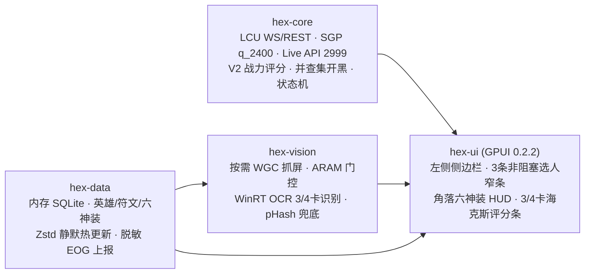

<div align="center">

# Hexrs

**面向《英雄联盟》海克斯大乱斗（ARAM Mayhem / KIWI）与斗魂竞技场（Arena）的极轻量级桌面辅助工具**

基于 **Rust + GPUI** 原生 GPU 加速架构打造 · 零遮挡选人决策 · V2 战力评分与开黑识别 · 3/4 卡海克斯实时 OCR 评分

<p>
  <a href="https://github.com/zoffyultraman/Hexrs/releases"></a>
  <a href="https://github.com/zoffyultraman/Hexrs/actions/workflows/build.yml"></a>
  
  
  <a href="./LICENSE"></a>
  <a href="./licenses/CC-BY-NC-4.0-LICENSE"></a>
</p>

<p>
  <a href="#核心特性">核心特性</a> ·
  <a href="#v2-海克斯大乱斗战力评分与开黑识别">V2 战力评分</a> ·
  <a href="#下载与快速上手">下载与使用</a> ·
  <a href="#自定义称号梯度">自定义配置</a> ·
  <a href="#项目架构">项目架构</a> ·
  <a href="#开源协议与数据声明-license--data-attribution">开源协议</a>
</p>

</div>

---

## 核心特性

Hexrs 围绕 **“不干扰操作、平时零开销、信息一眼即懂”** 三个目标设计，覆盖**选人决策**与**局内对局**全流程：

### 1. 选人阶段（Champ Select）· 四窗协同，绝不遮挡客户端交互

所有客户端叠层均采用**局部极窄独立窗口** + Windows 11 DWM 无边框净化（`DWMWA_COLOR_NONE`），严格避开头像、换英雄与卡牌点击区域：

| 悬浮模块 | 位置 | 核心能力 |
| :--- | :--- | :--- |
| **左侧吸附侧边栏** | 客户端左侧边缘（`320px`） | 全队英雄与备选池（Top 12）胜率排行、Top 5 搭档推荐与阵容短板诊断（缺法伤/前排/硬控）、自动展开当前英雄核心海克斯 Top 3 与**推荐六神装**、开黑车队摘要卡片 |
| **海克斯渐变队友条** | 左侧 5 名队友卡右侧 | 5 层 `#091428` 水平渐隐暗透遮罩 + 最右侧 `2px` 英雄梯度色条；第 1 行梯度与 `Consolas` 等宽胜率严格右对齐；第 2 行展示 V2 战力分与称号；第 3 行以半透描边**幽灵胶囊**并排显示开黑（`● 黑1`）、上局 **`★ MVP`** 与 `N连胜`/`N连败` |
| **备选池徽章条** | 顶部 10 格备选池正下方 | 动态按客户端分辨率与 DPI 缩放分布，精准对齐每个备选英雄头像下方 |
| **中央选卡徽章条** | 2 张 / 3 张选英雄卡正下方 | 通过 LCU `subset-champion-list` 实时读取海克斯大乱斗“选择你的英雄” 2 卡或 3 卡，在卡牌下方空白区渲染评级、英雄名与胜率，**零像素覆盖卡牌**，选定后立即隐藏 |

### 2. 局内阶段（In-Game）· 六神装 HUD + 3/4 卡海克斯自适应识别

* **紧致六神装角落面板（`324×204`）**：2×3 六格推荐出装，永久鼠标穿透（`WS_EX_TRANSPARENT`），托盘一键切换**左上角 / 右上角**；结合 `Live Client Data API (127.0.0.1:2999)` 实时高亮已购装备。
* **按需 WGC + WinRT 原生 OCR 动态 3/4 卡识别**：
  * 结合 ARAM 等级节点（`3 / 7 / 11 / 15 / 21` 级）与开局/阵亡/泉水状态门控按需抓屏，平时完全休眠零帧率损耗；
  * 自动兼容常规 **3 张海克斯卡** 与特殊乐队机制（如“音乐大师 烬”出现的 **4 张海克斯卡**），并具备单卡漏字插值补位能力；
  * 在每张海克斯卡牌正上方动态对齐渲染评分条，展示**英雄搭配梯度、平滑胜率、选取率**与金色 **`⚡ 完美协同`**（Lift 协同提醒）。

### 3. 极简便携与静默热更新

* **绿色便携目录**：无需安装运行库，运行时数据（`meta.db`、图标缓存、`rating_titles.json`、`hexrs.log`）默认保存在 `Hexrs.exe` 同级 `data/` 目录（若目录只读则自动回退至 `%LOCALAPPDATA%\Hexrs`）。
* **静默增量更新**：后台基于 `manifest.json` + SHA-256 校验 + `Zstd` 压缩包原子热更新 `meta.db`，系统托盘支持一键检查更新、切换角标位置、打开数据目录/日志及以管理员身份重启。

---

## V2 海克斯大乱斗战力评分与开黑识别

### 1. SGP + LCU 双通道纯模式采集

* **主通道（SGP）**：自动识别国服全部腾讯大区与外服节点，使用客户端本地 `/entitlements/v1/token` 令牌携带 **`tag=q_2400`** 一次请求拉满最近 **20 场纯海克斯大乱斗** 对局（不掺杂排位/匹配/云顶），且单次响应自带全员 10 人数据。
* **兜底通道（LCU）**：当 SGP 节点或令牌暂不可用时自动无缝降级到本地 LCU 接口拉取并在客户端按 `queueId == 2400 || gameMode == "KIWI"` 过滤。
* **样本与隐私规则**：自动剔除 `< 300s` 重开/秒投局；有效样本 `< 3` 场显示 `样本少`；国服私密生涯（401/403）统一显示灰色 **`隐藏`** 徽章。

### 2. V2 五维 100 分自适应评分模型

针对海克斯大乱斗节奏与符文改变英雄定位的特性，引入**贝叶斯平滑胜率**与**自适应 Top-2 定位贡献池**，消除纯 C 位、开团坦克与软辅之间的职业歧视：

| 维度 | 满分 | 计算逻辑（SGP 全队基准 / LCU 分均兜底） |
| :--- | :---: | :--- |
| **平滑胜率** | `25` | 贝叶斯平滑 $WR' = \frac{W + 2}{N + 4}$，映射区间 `0.25 ~ 0.75`（防极小样本刷满分） |
| **自适应 Top-2 定位池** | `35` | 逐局计算 **输出** / **有效坦度**（`totalDamageTaken + damageSelfMitigated`） / **功能**（`max(队友治盾, 控制时长 timeCCingOthers)`）归一化分，取最高两项按 `0.70 × S1 + 0.30 × S2` 加权后求均值 |
| **参团率** | `15` | 逐局 `(K + A) / 队总击杀` 映射 `0.38 ~ 0.85` 取均值 |
| **全局修正 KDA** | `15` | 先对近 20 场全局累加 `Σ(K + A) / max(ΣD, 1)` 再映射 `1.0 ~ 4.5`（杜绝单局 0 死拉爆均值） |
| **经济贡献** | `10` | 逐局 `个人经济 / 队均经济` 映射 `0.82 ~ 1.18` 取均值 |

### 3. 并查集开黑识别、各车队上局 MVP 与连胜/连败

* **开黑车队识别**：基于 `TeamUpGraph` + `UnionFind` 分析近 20 场海克斯大乱斗同队历史，两两同队 **`≥ 2` 场** 归组标记为 `● 黑1` / `● 黑2`（支持穿透隐藏战绩——只要车队内有一名成员公开战绩即可关联识别）。
* **车队独立“上局 MVP”**：对每个独立开黑小组（例如 `2 + 3` 对局中的 2 人组与 3 人组），各自提取该组最近一场共同同队对局，按 V2 单局 75 分表现模型评出每组最高分成员并授予金色 **`★ MVP`** 幽灵胶囊。
* **连胜 / 连败标签**：从最新一场纯海克斯大乱斗向前连续统计，达到 `≥ 3` 胜/负即展示 **`N连胜`** / **`N连败`** 短签。

---

## 下载与快速上手

> **架构提示**：目前仅支持 **Windows x86_64（64 位）** 架构，暂不支持 ARM64 或 32 位系统。

1. 前往仓库 [Releases](https://github.com/zoffyultraman/Hexrs/releases) 页面下载最新压缩包（如 `Hexrs-alpha_0.0.1-windows-x86_64.zip`）。
2. 解压后得到自带完整根目录的便携文件夹 `Hexrs/`：
   ```text
   Hexrs/
   ├── Hexrs.exe                 # 主程序（Windows x86_64，静态便携）
   ├── LICENSE                   # 本项目源代码协议 (GNU GPL-3.0)
   └── data/
       ├── LICENSE               # 第三方数据协议 (CC BY-NC 4.0)
       ├── meta.db               # 预置海克斯大乱斗英雄/符文/六神装数据库
       ├── version.txt           # 本地数据库版本号
       └── rating_titles.json    # 自定义召唤师称号梯度配置（支持热加载）
   ```
3. 双击 `Hexrs/Hexrs.exe` 启动，程序常驻系统托盘；打开《英雄联盟》客户端进入选人或对局后将自动切换工作模式。

### 自定义称号梯度

首次运行会在 `Hexrs/data/rating_titles.json` 自动生成默认配置（右键系统托盘 → **打开数据目录** 即可编辑）。修改分数阈值或文案保存后，**下次进入选人界面自动热加载，无需重启程序**：

```json
{
  "tiers": [
    { "min_score": 82, "label": "夯" },
    { "min_score": 70, "label": "顶级" },
    { "min_score": 58, "label": "人上人" },
    { "min_score": 45, "label": "NPC" },
    { "min_score": 0,  "label": "拉完了" }
  ],
  "insufficient_samples": "样本少",
  "private_profile": "隐藏"
}
```

<details>
<summary><strong>常见问题排查、环境变量与源码构建说明（点击展开）</strong></summary>

#### 1. 常见问题排查
* **局内悬浮窗被游戏遮挡**：请将游戏内视频显示模式设为**无边框窗口化**（独占全屏会阻止系统级置顶悬浮窗绘制）。
* **国服 / WeGame 下无法识别选人界面**：若客户端以管理员权限启动，请右键托盘选择**“以管理员身份运行”**（或打开诊断面板点击 UAC 提权按钮）。
* **Windows Defender / 安全软件误报**：内测版便携 `.exe` 暂未配置商业代码签名证书；所有发布产物均由本仓库 GitHub Actions 公开源码自动编译，核对发布记录后可手动加入信任白名单。

#### 2. 可选环境变量
* `HEXRS_MANIFEST_URL`：自定义热更新 `manifest.json` 地址（默认指向本仓库 `data` 分支）。
* `HEXRS_TELEMETRY_URL`：配置匿名战绩众包上报接收端 URL（默认未配置，自动跳过网络上报）。

#### 3. 从源码构建（Windows x86_64）
需要 Rust Stable (`x86_64-pc-windows-msvc`)、MSVC Build Tools、Windows SDK（含 `fxc.exe`）及 Python 3.12：
```powershell
python -m pip install -r scripts/requirements.txt
python scripts/fetch_cdragon.py --output dist/cdragon_meta.json
python scripts/calc_meta.py --input dist/cdragon_meta.json --out-dir crates/hex-data/assets
cargo build --release --target x86_64-pc-windows-msvc --bin Hexrs
```

</details>

---

## 项目架构



```text
Hexrs/
├── crates/
│   ├── hex-core/        # 进程监控、LCU/SGP 双通道、Live API (2999)、V2 评分与开黑引擎、状态机
│   ├── hex-vision/      # Windows.Graphics.Capture 按需抓屏、WinRT OCR 3/4卡识别、DCT-II pHash
│   ├── hex-data/        # 内存只读 SQLite 引擎、六神装与协同推荐、Zstd 热更新、脱敏 EOG 上报
│   └── hex-ui/          # GPUI 侧边栏、非阻塞选人窄条、六神装 HUD、海克斯评分卡、系统托盘
├── scripts/
│   ├── fetch_cdragon.py # 拉取 CommunityDragon 英雄/装备/海克斯静态元数据与一致 pHash
│   └── calc_meta.py     # 融合 czgreat/aramhex-data 生成平滑胜率、六神装、meta.db.zst 与 manifest.json
├── licenses/
│   └── CC-BY-NC-4.0-LICENSE
└── .github/workflows/   # Windows 自动构建、便携双协议 Release 打包与数据定时更新
```

---

## 合规与隐私承诺

* **零侵入安全红线**：绝不读取游戏内存、绝不注入 DLL、绝不修改封包、绝不使用 `SetWindowsHookEx` 全局钩子、绝无任何自动点击或代操作行为。
* **仅限官方与系统标准接口**：所有能力严格限定在官方本地接口（LCU / SGP / Live Client Data API）、`Windows.Graphics.Capture` 与系统原生 `Windows.Media.Ocr` 范围内。
* **最小化本地隐私处理**：选人阶段查询的队友 PUUID 与战绩仅在**本地内存缓存 10 分钟**用于界面展示，绝不写入本地磁盘、绝不上传至任何服务器；可选的匿名 EOG 统计在反序列化阶段即彻底剥离所有召唤师名称、Riot ID、PUUID 与对局 ID。

---

## 致谢与参考

* [czgreat/aramhex-data](https://github.com/czgreat/aramhex-data)：提供高质量的海克斯大乱斗英雄、海克斯符文与出装统计数据。
* [LeagueAkari](https://github.com/LeagueAkari/LeagueAkari)（MIT License）：本项目的 SGP `tag=q_2400` 队列查询策略、团队贡献比评分思想及图/并查集开黑推理方案均参考自其优秀的开源设计。
* [CommunityDragon](https://communitydragon.org/)：提供基础英雄、装备与海克斯图标及静态元数据。

---

## 开源协议与数据声明 (License & Data Attribution)

本项目采用**代码与数据分离**的许可方式：

### 1. 源代码协议
本仓库中的所有原创源代码均基于 **[GNU General Public License v3.0 (GPL-3.0)](./LICENSE)** 协议开源。你可以自由地使用、修改和分发这些代码。

### 2. 第三方数据协议
本项目运行所依赖的《英雄联盟》海克斯大乱斗相关统计数据来源于开源仓库 [czgreat/aramhex-data](https://github.com/czgreat/aramhex-data)（已获作者在 [Issue #4](https://github.com/czgreat/aramhex-data/issues/4) 中明确授权使用）。

* **数据许可协议**：该部分数据独立遵循 **[CC BY-NC 4.0（署名-非商业性使用 4.0 国际许可协议）](https://creativecommons.org/licenses/by-nc/4.0/deed.zh-hans)**（协议原文：[本地副本](./licenses/CC-BY-NC-4.0-LICENSE) / [上游原文](https://github.com/czgreat/aramhex-data/blob/main/LICENSE)），**不受本项目的 GPL-3.0 协议管辖**。
* **修改说明**：本项目对原数据进行了筛选与结构重组（结合贝叶斯平滑与 CommunityDragon / Data Dragon 基础元数据，构建本地只读 SQLite 索引与六神装推荐方案）。
* **商业使用提示**：Hexrs 本身完全免费且无商业用途。如果你计划基于 GPL-3.0 协议对本项目进行商业化分发或二次开发，**必须先移除 `aramhex-data` 相关数据并替换为自有数据源**，以免违反 CC BY-NC 4.0 的非商业性条款。
